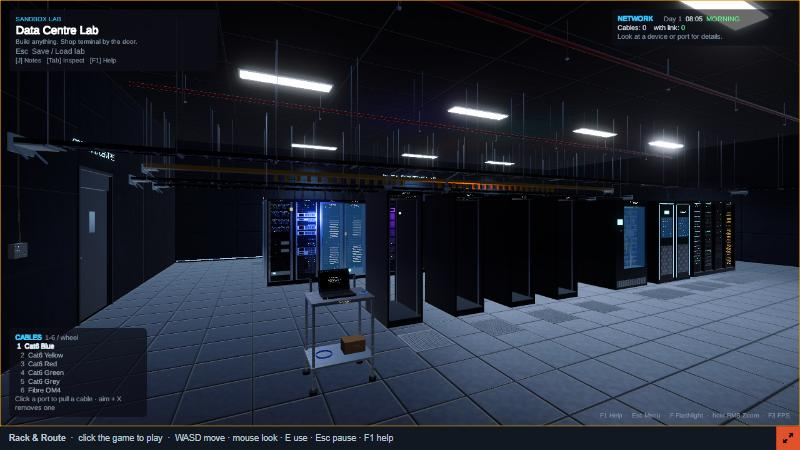
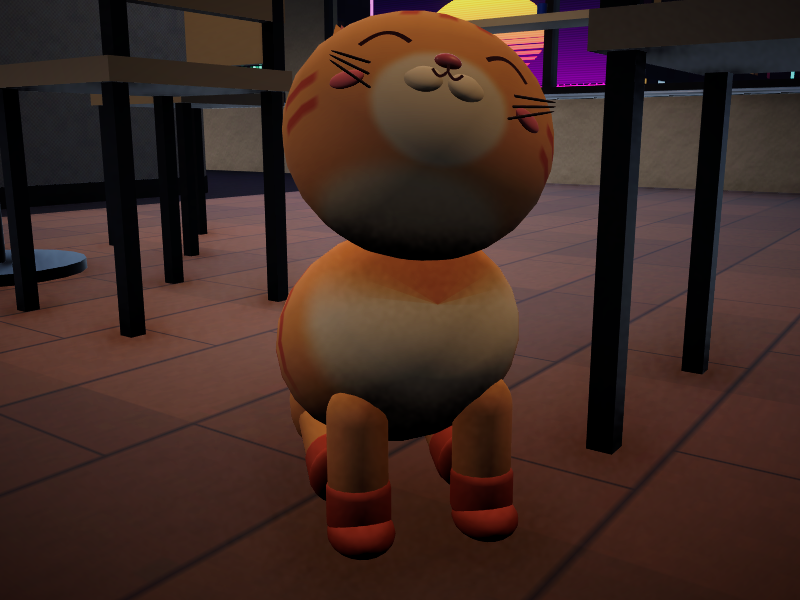

# Rack & Route

**A 3D network engineer game. Play it in your browser:**
**https://astrostar123.github.io/rack-and-route/**

Rack it, patch it, configure it, fix it. It's always the network's fault.

## What you do

- **Career:** five jobs that get harder as you go.
- **Troubleshooting:** a network is broken. Find out why and fix it.
- **Sandbox Lab:** your own data centre. Buy gear for free, rack it, cable it and configure it with a real command line (Cisco-style `enable`, `conf t`, `show ip int brief`...).
- **The office:** hire staff for two office floors. Their PCs ping through your network all day; in the busy hours your switches and routers can get overloaded, so upgrade them on the workbench.
- **Hardware:** hard drives, power supplies and fans wear out and break. Swap them before the server goes down.
- **Mango:** the office cat. Press E to pet her.

## Controls

| Key | What it does |
| --- | --- |
| Click the game | Start (the mouse is captured) |
| W A S D, mouse | Walk, look |
| E | Use: console, pick up, pet the cat |
| Left click | Ports: start / plug in a cable |
| R | Take a device out of its rack |
| Q | Turn a device (in your hands, on the bench, on a desk) |
| X | Put the cable away / remove a cable |
| 1 – 6, mouse wheel | Cable type and colour |
| Tab | Inspection mode |
| Esc | Pause menu (settings, save the lab) |
| F1 | Tutorial and command cheat sheet |

Your lab and settings are saved in your browser. A desktop browser (Chrome, Edge or Firefox) with a mouse and keyboard works best. The first load downloads about 33 MB.

## Made with

Unity 6 (Web build). The terminal font is [Roboto Mono](https://fonts.google.com/specimen/Roboto+Mono), Apache License 2.0 (see `RobotoMono-LICENSE.txt`).

This repository holds the playable web build only.
